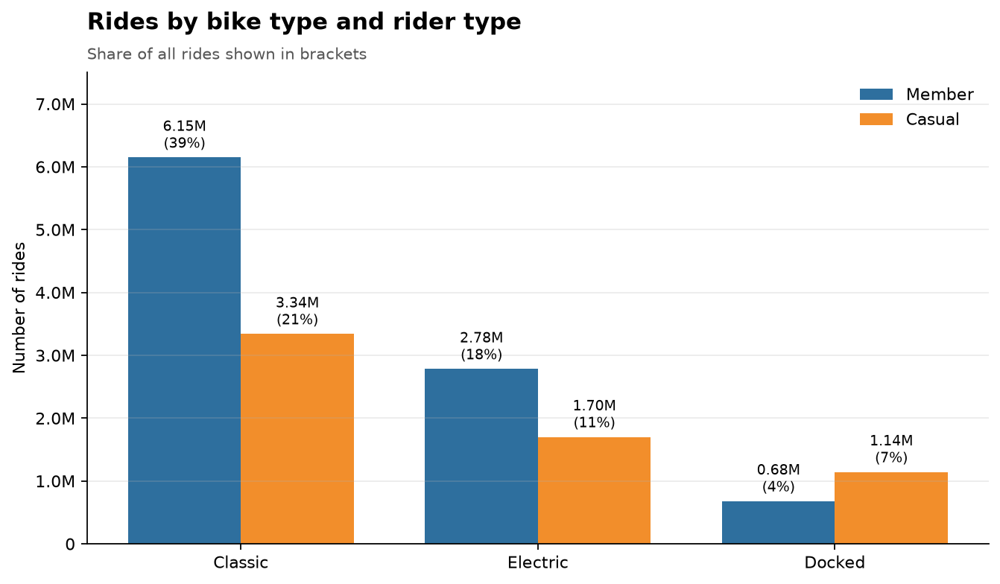
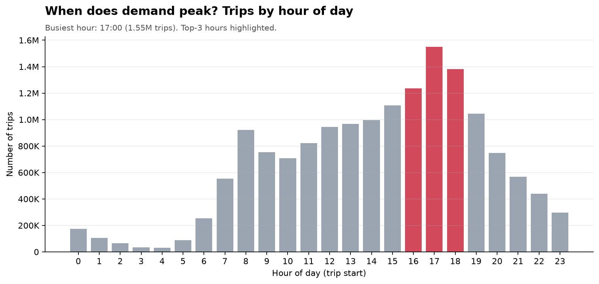
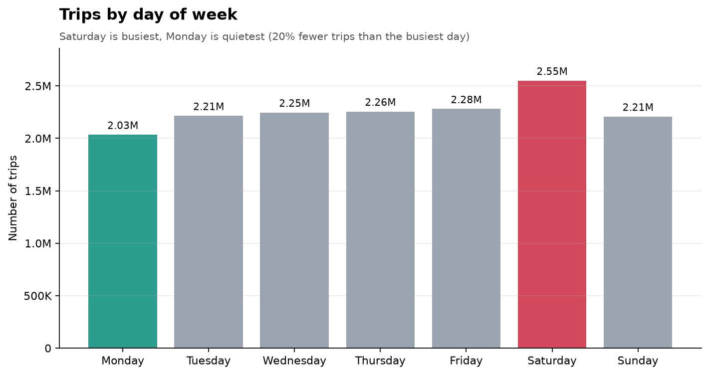
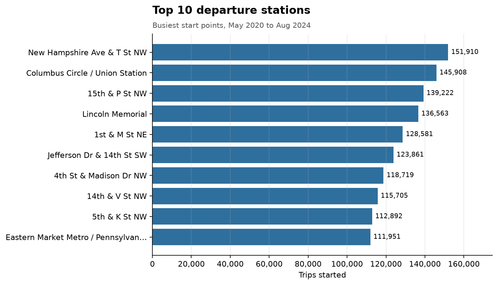
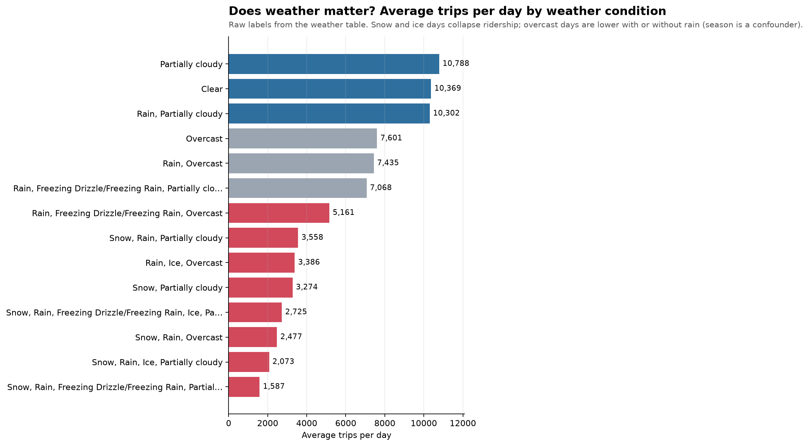

# 🚲 City Bike-Share Analysis

**A SQL and Python analysis of 16 million Capital Bikeshare trips (Washington, DC, May 2020 – Aug 2024): when people ride, where, on what, and how weather changes it.**

   

---

## Business questions

| # | Question | Where answered |
|---|---|---|
| 1 | Which stations are the busiest, and which are under-used? | Notebook §6.4 |
| 2 | When does demand peak (hours, weekdays, months)? | §6.2 |
| 3 | How do members and casual riders differ in trip length and timing? | §6.2, §6.3 |
| 4 | Are electric bikes ridden longer or more often than classic bikes? | §6.2, §6.3 |
| 5 | How much do rain and temperature change daily ridership? | §6.5 |

> The dataset has no fare column, so the *fare* part of question 3 cannot be answered. Trip duration is used instead.

## Highlights

These figures come from the SQL results in the notebook 

- **16.1 M trips**; members take **61%** of rides, casual riders **39%**.
- By bike type: **classic 60%**, **electric 29%**, **docked 12%** of rides.
- **Demand peaks at 17:00** (1.58 M trips) with a second, smaller peak at **08:00**: a classic commuter pattern.
- **Saturday is the busiest day, Monday the quietest** (Monday has ~20% fewer trips than Saturday).
- The busiest start station is **New Hampshire Ave & T St NW** (153,658 departures), followed by **Columbus Circle / Union Station** and **15th & P St NW**.
- **Snow and ice days collapse ridership** (roughly 1.6K–3.6K trips/day vs ~10.6K on clear days). Overcast days are lower with or without rain, which hints that season and weather are intertwined; the notebook separates them by comparing rainy and dry days within the same months.

The notebook also computes the remaining answers (cleaned trip durations by rider and bike type, under-used stations, net flow, temperature effect) and writes them to `reports/key_findings.md`.

## Visual gallery

| | |
|---|---|
|  |  |
|  |  |



## What we did

1. **Built a SQL database.** Loaded four CSVs into SQLite, streaming the 16 M-row trips file in chunks to keep memory low.
2. **Explored the data in SQL.** Answered the business questions with aggregations, `JOIN`s, `UNION ALL` (for station net flow) and date functions.
3. **Found and fixed a data-quality problem.** The EDA showed an average trip duration of **−145 minutes** for February 2024, which is impossible. An audit found trips that end before they start, trips under a minute and trips over 24 hours. I built a cleaned table (`trips_clean`) with explicit, documented rules and derived columns (`duration_min`, `hour`, `dow`, …), leaving the raw table untouched.
4. **Visualised the results.** Wrote reusable plotting functions (`src/plots.py`) with a consistent style, and used them in the notebook for 17 charts plus a one-page dashboard.
5. **Went beyond the first answer.**
   - *Under-used stations* are ranked by **trips per active day** among stations open at least a year, so new or closed stations don't skew the list.
   - *Weather* raw labels (14 combinations) were grouped into 5 categories, and rain is compared **within the same season** to avoid confusing weather with seasonality.
   - Every written insight in the notebook is **computed from the data** (and saved to `reports/key_findings.md`), so text can't drift from the numbers.
6. **Made it reproducible.** Command-line database builder, standalone SQL file, unit tests and a synthetic-data generator.

## Repository structure

```
city-bike-share-analysis/
├── README.md
├── requirements.txt
├── LICENSE
├── notebooks/
│   └── City_Bike_Share_Analysis.ipynb   # full analysis: SQL EDA → cleaning → visuals → findings
├── src/
│   ├── build_database.py                # CSVs → SQLite + cleaned table (CLI)
│   └── plots.py                         # reusable chart functions
├── sql/
│   ├── 01_data_quality_audit.sql        # how bad is the raw data? (duplicates, nulls, bad values)
│   ├── 02_data_cleaning.sql             # raw table → trips_clean (the cleaning rules)
│   └── queries.sql                      # all analysis queries (run after cleaning)
├── tests/
│   ├── make_sample_data.py              # tiny synthetic dataset (for testing only)
│   └── test_pipeline.py                 # cleaning rules, SQL file and plot smoke tests
├── images/                              # exported charts
├── reports/                             # key_findings.md (generated by the notebook)
└── data/                                # database lives here (git-ignored)
```
