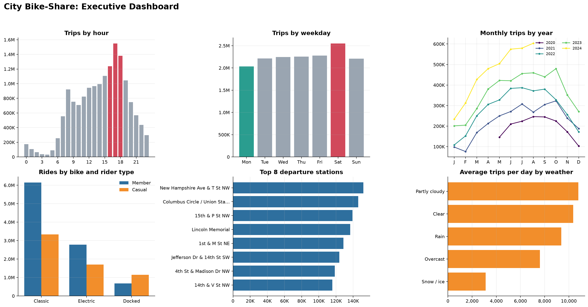
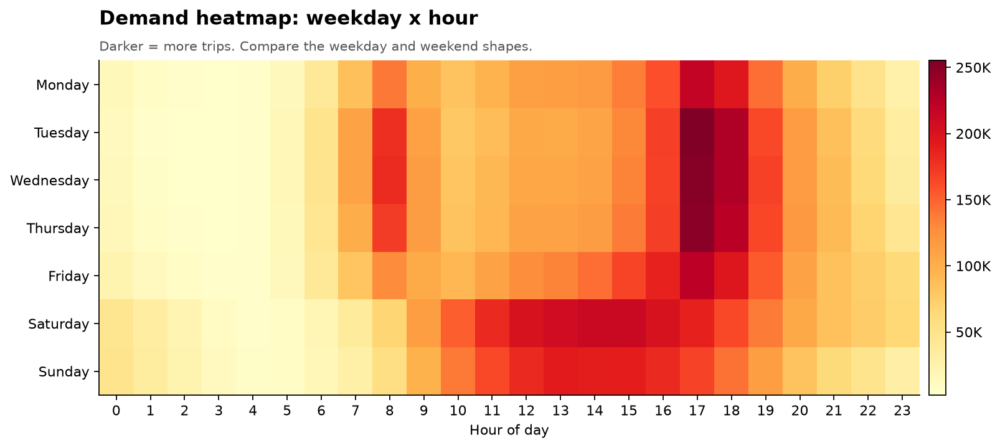
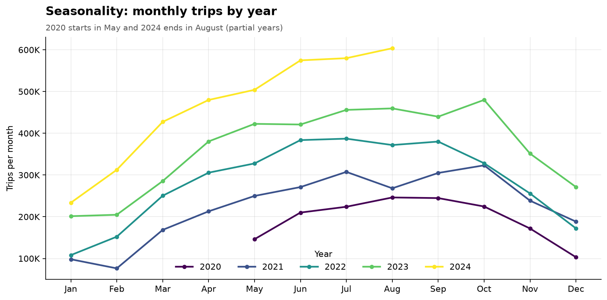
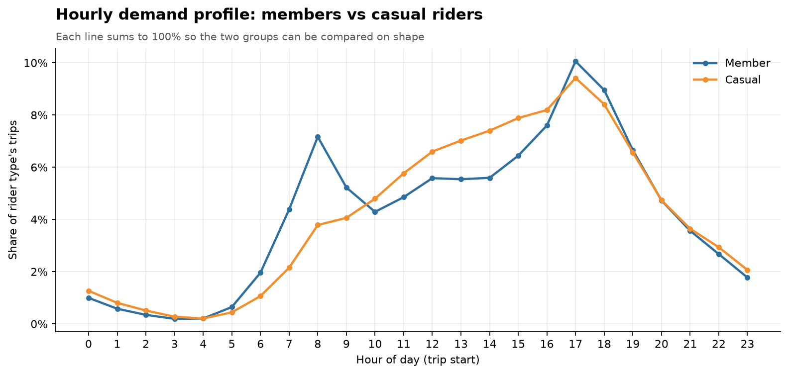
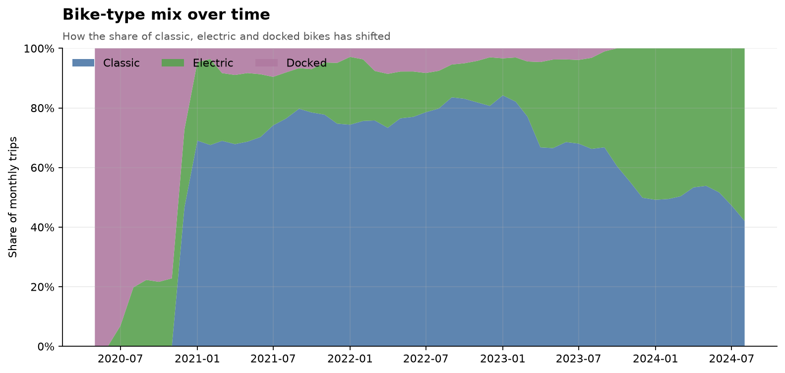
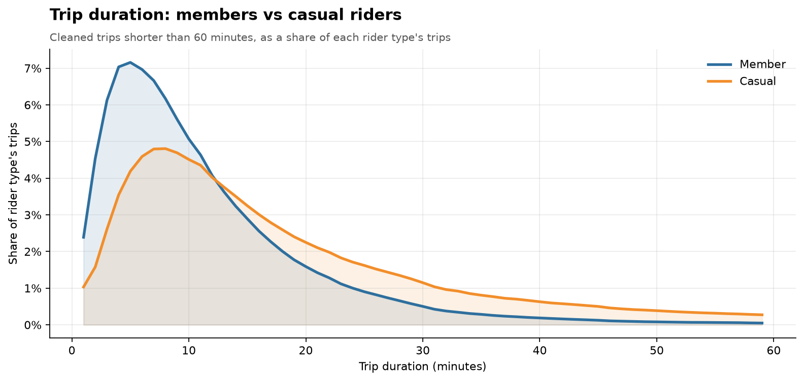
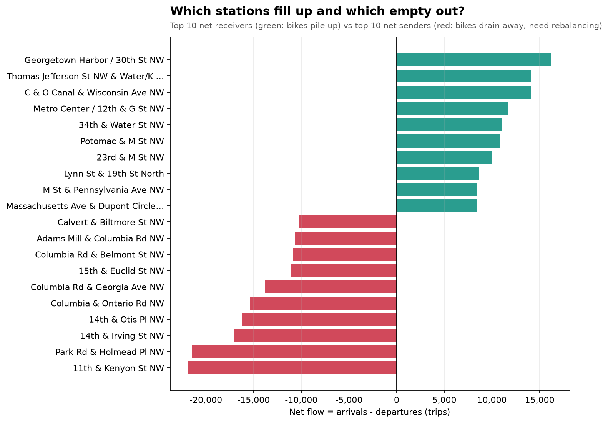
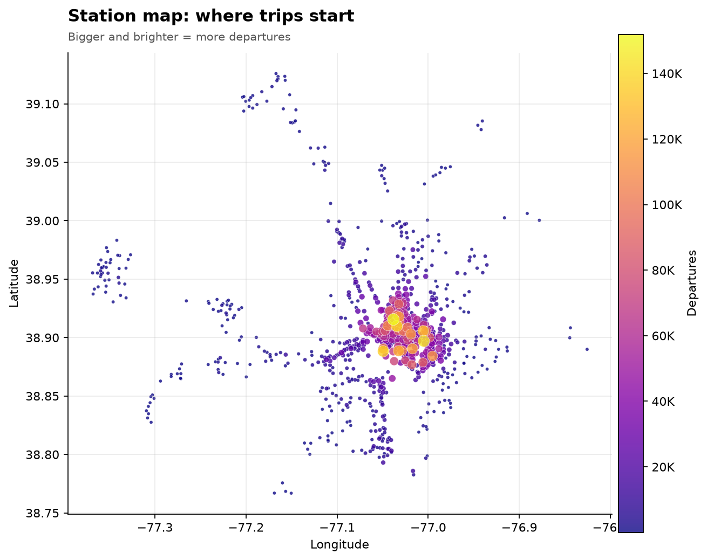
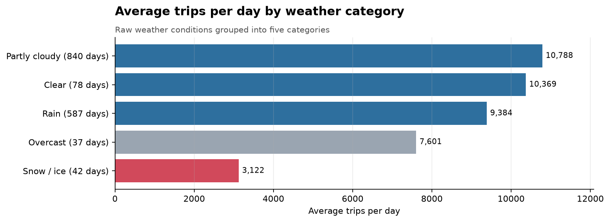
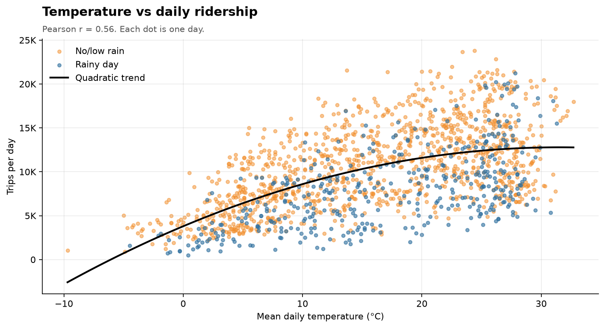

<h1 align="center">🚲 City Bike-Share Analysis</h1>

  <b>SQL + Python analysis of 15.8 million Capital Bikeshare trips in Washington, DC (May 2020 – Aug 2024)</b> 
  When people ride, where, on what, and how the weather changes it.

  
  
  
  
  

  

---

## Overview

This project turns raw bike-share trip records into clear answers about how the system is used. The trips, stations and daily weather are loaded into a SQLite database, explored and cleaned with SQL, then analysed and visualised with Python.

The full walkthrough is in [`notebooks/City_Bike_Share_Analysis.ipynb`](notebooks/City_Bike_Share_Analysis.ipynb).

## Questions answered

| Question | Where |
|---|---|
| Which stations are busiest, and which are under-used? | Notebook §6.4 |
| When does demand peak: hours, weekdays, months? | §6.2 |
| How do members and casual riders differ in trip length and timing? | §6.2, §6.3 |
| Are electric bikes ridden more often or for longer than classic bikes? | §6.2, §6.3 |
| How much do rain and temperature change daily ridership? | §6.5 |

## Key findings

All figures are computed from the cleaned data (15,790,956 trips); the full list is saved by the notebook to [`reports/key_findings.md`](reports/key_findings.md).

**Demand**
- Ridership peaks at **17:00** (about 1.55 M trips), with a second peak at **08:00**.
- **Saturday** is the busiest day and **Monday** the quietest (20% fewer trips than Saturday).
- **July** averages 12,610 trips per day; **January** only 5,172.
- Full-year ridership grew from **2.7 M trips in 2021 to 3.4 M in 2022 and 4.4 M in 2023**.

**Riders**
- Members make **61%** of rides and casual riders **39%**.
- Casual trips are **2.1x longer**: 28.3 minutes on average vs 13.4 for members. 53% of member trips are under 10 minutes, against 32% of casual trips.
- Members ride like commuters: 35% of their trips are weekday commute-hour trips (7–9h, 16–18h) vs 25% for casual riders. Casual riders ride at weekends: 37% of their trips vs 26% for members.

**Bikes**
- Classic bikes account for 60% of rides, electric 28%, docked 12%.
- Electric bikes grew from about **15% of trips in 2020–2022 to 31% in 2023 and 51% in 2024**, while docked bikes went from 82% of 2020 trips to 0% in 2024.

**Stations**
- The busiest start station is **New Hampshire Ave & T St NW** (151,910 departures).
- 389 stations receive more bikes than they send and 418 lose bikes. The largest net receiver is **Georgetown Harbor / 30th St NW** (+16,217) and the largest net sender is **11th & Kenyon St NW** (−21,841): the natural rebalancing hotspots.
- The median established station sees 5.2 departures per day; the ten least-used average just 0.2.

**Weather**
- Between June and September, rainy days (1 mm or more) average **22% fewer trips** than dry days (10,289 vs 13,128).
- From December to March, snow days average **56% fewer trips** than days without snow (3,056 vs 7,019).
- Temperature and daily trips correlate at **r = 0.56**. Ridership climbs with temperature up to about 20 °C, then levels off (about 12,400 trips per day above 20 °C).

## Visual gallery

| | |
|:---:|:---:|
|  |  |
|  |  |
|  |  |
|  |  |
|  |  |

All 18 images are in [`images/`](images).

## Approach

1. **Load.** Four CSV files are loaded into SQLite; the 16 M-row trips file is streamed in chunks to keep memory low.
2. **Explore with SQL.** Aggregations, joins and `UNION ALL` answer the first round of questions (fleet mix, busiest hours and days, top stations, station net flow, member vs casual, weather).
3. **Audit and clean.** Duplicates, invalid timestamps, very short and very long trips and bad coordinates are handled in one reproducible SQL script that builds the table `trips_clean`. The raw tables is never modified.
4. **Visualise.** Reusable plotting functions in [`src/plots.py`](src/plots.py) produce 17 charts and a one-page dashboard in a consistent style.
5. **Dig deeper.** Under-used stations are ranked by trips *per active day* among stations open for at least a year. Weather is compared *within the same season* so that rain is not confused with winter.
6. **Report.** Findings are computed in the notebook and written to `reports/key_findings.md`, so the text always matches the data.

## Tech stack

Python · SQLite · SQL · pandas · NumPy · Matplotlib · Jupyter

## Data

[Capital Bikeshare dataset on Kaggle](https://www.kaggle.com/datasets/taweilo/capital-bikeshare-dataset-202005202408): trips, stations, usage frequency and daily weather for Washington, DC. The data is not stored in this repository; see [`data/README.md`](data/README.md).
SQL (aggregations, joins, `UNION ALL`, date functions) · data auditing and cleaning · Python and pandas · data visualisation and storytelling · reproducible project structure · unit testing

## License

Released under the [MIT License](LICENSE).
